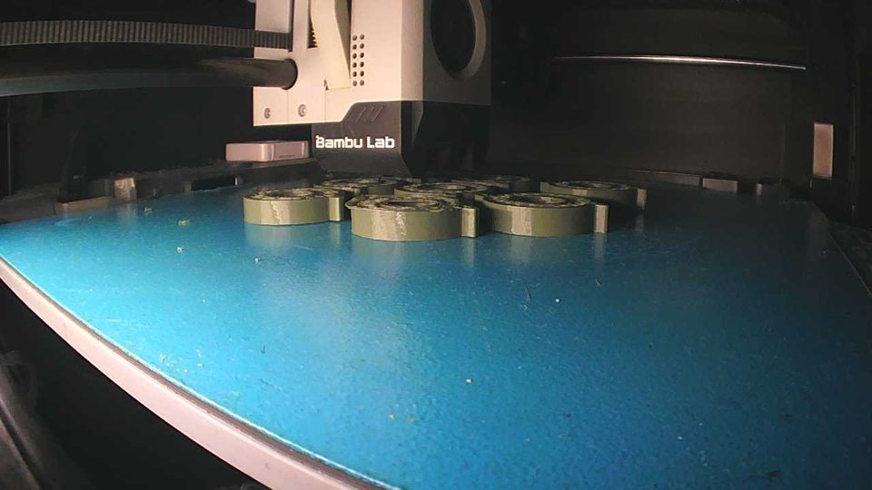
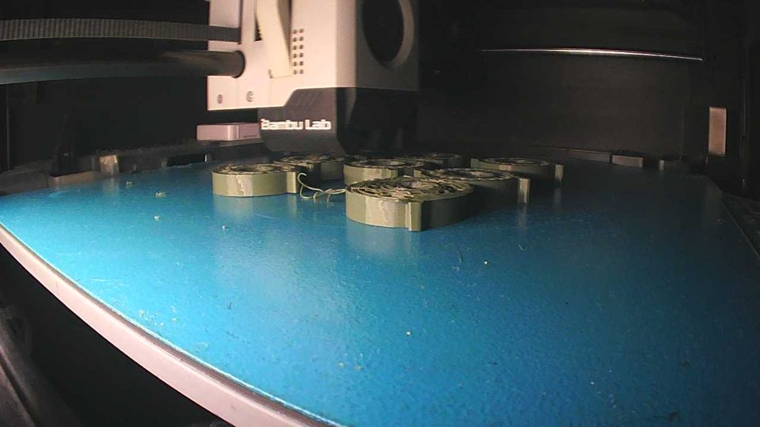
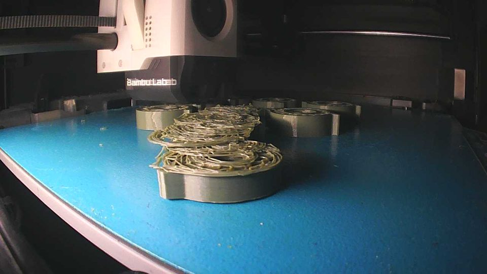

# Field reports

Real failures on the maintainer's P1S and what the monitor did with them. Times are local. Timelines are reconstructed from archived frames and Home Assistant history; anything not taken from that data is marked as an assumption.

## 2026-10-07/08: detached parts on a 7-part plate

**Print:** seven identical parts with lattice infill on one plate, a long overnight print.
**Settings:** package v0.1.1 defaults, AI and Auto Pause on, Notify Only off, sensitivity 1.0.
**Outcome:** two auto-pauses, both on real failures. The owner stopped the print later; 2 of 7 parts finished.
**Suspected root cause (not verified):** poor bed adhesion, from a dusty plate and a cold room (the printer stands on a balcony).

### Case 1: a part detached, paused after about 21 minutes

| Time | What happened |
| --- | --- |
| 2026-10-07 22:39 | False warning on the **first layer**. The thin outlines on the bare plate looked like strings to the model. No review button was pressed, so `alert_active` stayed on and any further warning was suppressed for about 1.5 h. |
| 23:35–23:48 | Normal parts. Frame `p` was 0.5–1.2 and the score reached about 0.7, but there was no alarm: the per-print mean had risen with these values, so the relative condition `score > 3.8 × (print mean - baseline)` was not met, and the score stayed below the absolute limit of 0.78. |
| 23:48–23:49 | One part detached from the plate (frames 1 and 2 below). |
| 23:49–00:05 | The printer kept printing the detached part into the air. The spaghetti was small and far from the camera; the model barely saw it, and frame `p` was often 0. |
| 2026-10-08 00:10:00 | **Auto-pause**, score 1.3785, about 21 minutes after the detachment (frame 3). |
| After the pause | The owner skipped 2 objects on the printer and resumed. |

| Before (23:48) | Detached (23:49) | Auto-pause (00:10) |
| --- | --- | --- |
|  |  |  |

The pause itself worked as designed: the pause level does not check `alert_active`, so the stale alert did not block it. The stale alert did block warnings for 1.5 h; whether a warning would have fired earlier without it is not known.

### Case 2: a second failure on the same print

| Time | What happened |
| --- | --- |
| about 01:03 | Warning, score 0.6546. |
| within about 2 min | **Auto-pause**, score 1.3779. |
| After the pause | The owner stopped the print. |

When this failure started was not measured, so the detection delay for case 2 is unknown.

### What changed in v0.2.0

- **First layers are skipped** (`min_layer: 3`). This targets the 22:39 false warning. The value 3 is an assumption, not a measured optimum.
- **Stale alerts clear themselves** after the score has stayed below 0.38 for 10 minutes while printing. In case 1 the alert should then have cleared about 10 minutes after the score fell back, and later warnings would have notified again; this was not replayed against the recorded data. The 10 minutes are an assumption as well.

Neither change makes the model see a small failure sooner. With the P1S camera, a small failure on a part far from the camera can go unnoticed for many minutes; in case 1 it took about 21. The monitor limits the damage, it does not replace good bed adhesion.
